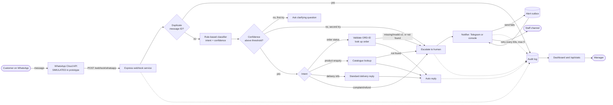

# Lead Systems & Automation Engineer Assessment (Version 1.1)

**Chosen context: Retail and order enquiries**
**Candidate:** Emmanuel Seun Shittu

---

## A. Problem and Solution Brief

### The business (fictional)
**Zuri Gadgets & Wears** is a growing online shop in Benin City, Edo State selling fashion and small electronics. Nearly all customer contact arrives on WhatsApp. Two to four staff reply by hand between other duties.

### The problem
- Customers repeat the same questions (where is my order, how much is X, how long is delivery) and wait for a person to be free.
- Messages are often incomplete (no order number), so staff spend time asking for basics.
- Follow-up is inconsistent, and the manager cannot see what was answered, escalated, or forgotten.

### Users
| User | Need |
|---|---|
| Customer | A fast, correct answer or a clear handover to a person |
| Support staff | Only the messages that need a human, with context attached |
| Manager | Visibility: volume, categories, escalation rate, unresolved cases |

### Intended outcome
Answer routine enquiries immediately, send everything else to a person with context, and give the manager an honest operational view. This is a first-stage system, not a replacement for staff.

### Scope: what the system does
1. Receives an incoming message (WhatsApp Cloud API payload shape, simulated in the prototype).
2. Classifies it into one of four intents: **order status**, **product enquiry**, **delivery info**, **complaint/refund**. Anything else is "unknown".
3. Replies automatically for routine intents and collects the minimum data needed (for example, a valid order ID in the form `ORD-1234`).
4. Escalates to a human and alerts staff when a case is sensitive, unclear, or unresolved.
5. Records every step in an audit log and shows a basic dashboard.

### What I deliberately chose not to automate
- **Refund and complaint decisions.** These always go to a person. Money and reputation are at stake.
- **Order changes, cancellations, and payments.** Higher impact than the first version should take on.
- **Free-text AI answers.** The classifier is rule-based so behaviour is predictable, free to run, and explainable to a non-technical manager. An LLM fallback is a later option only for low-confidence messages.
- **Customer identity checks.** The order ID is the lookup key in this version, which is a known limitation (see Section F).

### Assumptions
The brief is intentionally incomplete, so I assumed:
- One shared staff queue, not per-agent routing.
- Staff are alerted through a team chat channel (Telegram in the prototype). Alerts print to the console if no token is set.
- Order, product, and delivery data live in a small table. In production this would come from the shop's existing order system or spreadsheet.
- Delivery fees and times are fixed (Benin City, Edo State, 1 to 2 working days, ₦1,500; other states 3 to 5 days, ₦3,500).
- Customers write in English or simple Nigerian-English phrasing. Pidgin and Yoruba/Igbo/Hausa phrases are not yet recognised and would fall to the human path.
- Volume is low (tens to a few hundred messages a day), so one small server is enough.
- All data is synthetic. No real customer data is used.

### Questions I would confirm with a real client
The client here is fictional, so these are stated as assumptions above, but in a real engagement I would validate them first:
- Which message types make up most of the volume, and when are the peaks?
- Who handles refunds and complaints today, and what are they allowed to decide?
- Where do order and stock records live, and how current are they?
- What response time do customers expect, and what do staff actually achieve?
- What counts as "resolved", and who needs the weekly numbers?

### Constraints
- Limited technical staff, so the system must be simple to run and hand over.
- Tight recurring cost, so no paid services are required for the prototype.
- Human judgement must stay available for sensitive and high-impact cases.
- Production WhatsApp requires a Meta Business account and an approved provider. This is simulated here.

### Simulated versus working
| Component | Status |
|---|---|
| Webhook, classification, replies, validation, escalation, audit log, dashboard, duplicate handling, alert retry queue | **Working** |
| WhatsApp message delivery (inbound/outbound) | **Simulated.** Inbound uses the same payload shape as the Cloud API. Outbound replies are returned in the HTTP response rather than sent to a phone. |
| Staff alerts | **Simulated by default** (console). Real Telegram delivery works when `TELEGRAM_BOT_TOKEN` and `TELEGRAM_CHAT_ID` are set. |
| Order, product, and delivery data | **Synthetic seed data** |

### Known limits of version 1
- Keyword scoring is crude. It can misread a message that mixes topics, and it gives low confidence on ties. That is why low confidence leads to a question first and a human second.
- The dashboard login is basic (one shared account over HTTP Basic). Production needs HTTPS and per-person accounts.
- SQLite on one server is not highly available.

---

## B. System Architecture

### How it works
- **Trigger:** a `POST /webhook/whatsapp` carrying the Cloud API payload shape. In production, Meta is pointed at this URL. The prototype uses curl or the test runner.
- **Workflow logic:** the handler first checks the message ID against a `seen_messages` table so retried deliveries are ignored. It then classifies the text and tracks a small per-phone conversation state (for example, "awaiting order ID" with an attempt counter). The logic is in one file, `handler.ts`.
- **Integrations:** WhatsApp (simulated), Telegram for staff alerts (optional), and a local data store for orders and products. Swapping the data store for the shop's real order system is a single lookup function.
- **Data storage:** SQLite (built into Node 22). Tables: `orders`, `products`, `conversations`, `seen_messages`, `audit_log`, `notify_outbox`.
- **Human escalation:** complaints and refunds always escalate. Other cases escalate after two failed attempts (low confidence or invalid order ID), or when a lookup finds nothing. The customer is told a team member will reply.
- **Logging:** every step writes a timestamped row to `audit_log` (received, classified, replied, validation failed, escalated, notified, duplicate ignored, notify failed). The dashboard and `GET /api/events` read from it.
- **Failure handling:**
  1. *Duplicate message:* ignored and logged.
  2. *Low-confidence or incomplete message:* clarifying question, then escalation.
  3. *Notifier outage:* the alert is saved to an outbox and retried every 60 seconds (up to five attempts). The customer still gets the handover reply, and the dashboard shows pending alerts.
- **Tool choice (code, not n8n/Make/Zapier):** a small TypeScript service keeps the classification, validation, duplicate and audit logic under automated tests (13 passing), runs free on one small server, and avoids per-task pricing that grows with message volume. The trade-off is that staff cannot edit the flow visually. I have not built an n8n version for this submission, but the design maps node for node (webhook trigger, code node, switch, database and notification nodes, error workflow for retries); the mapping is in the README.
- **Why this shape:** one small service, one file-based database, no paid components. A junior engineer can read the whole system in under an hour, and the cost stays near the price of a small server.

---

## E. Cost and Commercial Feasibility

**All figures are planning estimates in naira (₦), not quotes. Rates must be re-checked on Meta's current rate card and the chosen provider's price list before any client commitment.**

### Key finding: messaging fees now dominate the bill
From 1 October 2026 Meta charges per message for service (free-form) replies sent inside the 24-hour window, which were free before. Reports put a chargeable utility/service message to a Nigerian number at about US$0.0101, roughly ₦14 at ₦1,340/US$. One provider also reports 1,000 free service messages per business number per month. I could not confirm that on Meta's own page, so I **do not rely on it**. Customer messages to the business are not charged.

### Assumed volume
150 customer messages a day (about 4,500 a month). About 30% escalate (1,350), and staff send about 2 replies per escalated case through the same API line (about 2,700). The system sends about 4,500 replies (one per inbound message). Total chargeable outbound: **about 7,200 messages a month**.

| Item | Setup (one-off) | Monthly |
|---|---|---|
| Software (Node.js, SQLite, Express, all open source) | ₦0 | ₦0 |
| Small cloud server (1 vCPU / 1 to 2 GB RAM) | ₦0 | about ₦10,000 to ₦12,000 (estimate) |
| Domain and TLS certificate | about ₦15,000 | about ₦1,500 (TLS free via Let's Encrypt) |
| Backups (daily database copy to object storage) | ₦0 | about ₦1,000 to ₦2,000 |
| Staff alert channel (Telegram) | ₦0 | ₦0 |
| WhatsApp Business account and provider onboarding | about ₦0 to ₦30,000 (provider-dependent) | provider fee, if any |
| **Meta per-message fees, 7,200 × ₦14** | n/a | **about ₦100,000 (worst case)** |

### Cost drivers and cost per transaction
- **Fixed run cost: about ₦13,000 to ₦16,000 a month.** Infrastructure is cheap.
- **Variable cost: about ₦14 per outbound message, about ₦22 per customer enquiry** (about 1.6 outbound messages each). This is the main cost driver, and it grows with volume.
- **Levers to cut it:** answer in one message (no "anything else?" filler), keep clarifying questions to one, and let staff batch their replies. These cost nothing to build and are already how the prototype behaves for routine intents.

### Affordability and pricing approach
- The saving is staff time. At 150 messages a day, about 70% are handled without a person. The shop should compare the roughly ₦115,000 total monthly cost with what one extra support hire would cost in its own payroll.
- **Proposed pricing:** (1) one-off setup of about ₦150,000 covering configuration, data connection and handover training; (2) a monthly service fee of about ₦35,000 to ₦50,000 covering hosting, monitoring, backups and small changes; (3) **Meta fees passed through at cost with no markup**, shown as a separate line so the client sees exactly what drives the bill.
- **Reduced-budget fallback (also a live-stage scenario):** cut the staff alert channel to a daily summary, remove clarifying questions, and cap auto-replies to the three highest-volume intents.

---

## F. Risk, Reliability, and Security Note

### Legal frame: Nigeria Data Protection Act 2023 (NDPA)
The system processes phone numbers, message text, and order details, which are personal data. The shop is the **data controller** and the engineer or provider is a **processor**. Points that apply:
- **Lawful basis (s.25) and principles (s.24):** processing to answer a customer's own enquiry fits performance of the customer's request. The basis must be documented, and only data needed for the purpose should be collected.
- **DPIA (s.28):** required where processing is likely high risk. Automated decision-making, e-commerce, and cross-border transfers are the triggers to review. Because the system classifies messages automatically and a third-party alert tool may sit outside Nigeria, a short DPIA should be done before production.
- **Breach notification (s.40):** notify the Nigeria Data Protection Commission within 72 hours of becoming aware of a breach likely to risk individuals' rights, and inform affected people.
- **Cross-border transfer (Part VIII):** Telegram and some hosts store data abroad. Transfers need adequate protection or another lawful mechanism.
- **DPO (s.32):** required if the shop is classed as a data controller of major importance. Otherwise a named privacy contact is still sensible.

### Risk register
| # | Risk / failure point | Impact | Mitigation | Status |
|---|---|---|---|---|
| 1 | **Misclassification** of a mixed or unusual message (keyword scoring is crude) | Wrong or unhelpful reply | Confidence threshold; ties score low; one clarifying question then human; complaints always human; weekly review of "unknown" and escalated messages | **Implemented** (review step planned) |
| 2 | **Staff alert fails** (Telegram outage, bad token) | Escalated customer is never answered | Outbox queue with retries every 60 s (max 5), audit event, dashboard "alerts pending" | **Implemented and tested** |
| 3 | **Duplicate webhook delivery** | Double replies, inflated stats, double cost | Message-ID dedupe table; duplicate logged and ignored | **Implemented and tested** |
| 4 | **Meta dependency and pricing change** (rates, policy, template rules, payment method on file or messages stop delivering) | Cost rise or service stops | Pass-through billing; monitor Meta notices monthly; keep the handler channel-agnostic so a provider swap changes one adapter; staff can fall back to manual replies | **Planned** |
| 5 | **Unauthorised access.** The dashboard and `/api/*` expose message text; the log holds phone numbers | Personal data exposure (NDPA breach) | Dashboard and API require a login, the server refuses to start in production without a password, comparison is constant-time, API output masks phone numbers. Still needed before real data: HTTPS, per-person accounts and roles (manager read, admin write), network restrictions, webhook signature check | **Partly implemented** (shared login, masking); HTTPS and roles planned |
| 6 | **Data minimisation and retention.** Staff alerts leave the system (Telegram, hosted abroad); the audit log has no expiry | Unnecessary cross-border exposure; over-retention | Alerts carry only a case reference, reason and intent, and staff read the case in the dashboard (tested, T13). Still needed: retention limit (for example 90 days) with a scheduled purge | **Alert minimisation implemented and tested**; retention purge planned |
| 7 | **Order-ID guessing.** Anyone who guesses `ORD-1002` sees its status (no identity check) | Information leak | Match the order to the sender's WhatsApp number; rate-limit lookups per number; never reveal address or payment details in replies | **Planned** (replies already limited to status and ETA) |
| 8 | **Spam or misuse** (message floods, abusive content, cost-inflation attack) | Fee spike, alert fatigue | Per-number rate limits, daily outbound cap with alert, block list, verify Meta webhook signature | **Planned** |
| 9 | **Single server and single-file database** | Outage or data loss | Daily backup, restore test, process restarts automatically; move to managed Postgres if volume or uptime needs grow | **Planned** |

### Auditability and continuity
- Every action writes a timestamped `audit_log` row (received, classified, replied, escalated, notified, duplicate, notify failed). It is append-only in normal use.
- Continuity: if the system is down, WhatsApp messages still arrive on the shop's number, so staff can answer manually. The runbook (Section G) covers restore and the manual fallback.
- Secrets are kept in environment variables only. No credentials are committed (`.env.example` holds placeholders).

---

## G. Operations Runbook

**Audience:** a technical or operations team member who did not build the system. Commands run from the `02_Prototype` folder.

### Start
1. Requirements: Node 22.13 or newer.
2. First time: `npm install`, then copy `.env.example` to `.env` and fill in values (`VERIFY_TOKEN`, `DASHBOARD_PASSWORD`, optional `TELEGRAM_BOT_TOKEN` and `TELEGRAM_CHAT_ID`, `DB_PATH`). Set `NODE_ENV=production` on the live server; it then refuses to start without a dashboard password.
3. Run: `npm start`. In production keep it alive with a process manager (for example `pm2 start "npm start" --name zuri-bot`) so it restarts after a crash or reboot.
4. Check: open `http://<server>:3000/` and sign in with `DASHBOARD_USER` and `DASHBOARD_PASSWORD`. `GET /api/stats` (with the same login) returning JSON means the service is up. A 401 means the service is up but the login is wrong. The database file is created on first start.
5. Smoke test: `npm test` should print 13/13 passed. It uses a throwaway database and does not touch live data.

### Monitor
Check the dashboard daily (a manager can do this) and `/api/stats` from an uptime checker every few minutes.

| Signal | Normal | Act when |
|---|---|---|
| Alerts pending | 0 | above 0 for more than 10 minutes (alert channel is failing) |
| Unresolved conversations | falls through the day | grows steadily (staff are not clearing escalations) |
| Escalation rate | stable, about 30% in the plan | doubles overnight (classifier or customer behaviour changed) |
| "unknown" intent count | low | rising (new phrasing; add keywords) |
| Duplicates ignored | a few | large spike (provider retry storm) |
| Process | running | restarted repeatedly (check logs) |

### Troubleshoot
| Symptom | Likely cause | Fix |
|---|---|---|
| No messages arrive at all | Webhook URL or provider config wrong, server down, port blocked | Confirm service is up; confirm provider points to `/webhook/whatsapp`; check firewall |
| Provider says webhook verification failed | `VERIFY_TOKEN` in `.env` differs from the one entered at the provider | Make them identical, restart |
| Staff alerts show a case reference only (by design) | Alerts hold no phone number or message text | Sign in to the dashboard and find the case in the activity log |
| Staff not receiving alerts, "alerts pending" above 0 | Telegram token or chat ID wrong, Telegram unreachable | Fix `.env`, restart. Queued alerts are re-sent automatically every 60 s (up to 5 tries per alert); check the audit log for `notify_failed_queued` and `outbox_retry_sent` |
| Alerts still pending after 5 tries | Outage outlasted retries | Fix the cause, then raise attempts for stuck rows (`UPDATE notify_outbox SET attempts=0 WHERE sent=0`) or notify staff manually from the audit log |
| Customer gets the wrong answer | Classifier keyword gap or tie | Read the `classified` rows in the audit log, add or adjust keywords in `src/classifier.ts`, add a test case, run `npm test` |
| Order says "not found" for a real order | Order data not loaded or stale | Check the `orders` table; production should read the shop's real order source |
| Service crashes on start | Wrong Node version, missing `.env`, unwritable `DB_PATH` | Check `node -v` (22.13+), check file permissions |

### Maintain
- **Backups:** daily copy of the database file (`DB_PATH`) to separate storage. Prefer SQLite's backup command (`sqlite3 data.db ".backup backup.db"`) so the copy is consistent while the service runs. Test a restore monthly: stop the service, replace the file, start, check `/api/stats`.
- **Changes:** edit in a branch, run `npm test`, get a second person to review, then deploy. Do not edit files on the live server.
- **Keywords and replies:** keywords live in `src/classifier.ts`; reply text and delivery fees in `src/handler.ts`; seed data in `src/db.ts`.
- **Review loop (weekly, 15 minutes):** read the escalated and "unknown" messages, decide which deserve a new rule or reply.
- **Log retention:** delete audit rows older than the retention limit once the purge job exists (see Section H).
- **Manual fallback if the system is down:** messages still reach the shop's WhatsApp number. Staff answer manually, then note anything unanswered once service returns.
- **Rotating secrets:** change the Telegram token or `VERIFY_TOKEN` in `.env`, update the provider, restart.

---

## H. Handover and 90-Day Plan

### Handing the solution to a junior engineer
1. **Reading order (about 1 hour):** README, Section B diagram, `handler.ts` (the whole flow), `classifier.ts`, then `notifier.ts`. The system is deliberately small enough to read in one sitting.
2. **Run it:** follow the runbook, run `npm test`, send three messages from `test_inputs`, watch the audit log and dashboard change.
3. **Graduated first tasks:**
   - Week 1: add keywords for a missed phrasing (for example Pidgin) with a matching test case.
   - Week 2: add one reply and one test for a new FAQ, such as store opening hours.
   - Week 3: add a new intent end to end (classifier rule, handler branch, test, dashboard row).
4. **Safe review:** every change goes through a branch and pull request. The reviewer runs `npm test`, reads the diff against the audit-log behaviour it should produce, and checks three questions: does it ever send customer data somewhere new, does it keep complaints on the human path, and is there a test? Nothing reaches production without a second person's approval.
5. **Pairing and escalation:** pair on task one, review asynchronously after that. A junior never changes escalation rules, secrets or data retention alone.

### First 30, 60 and 90 days if the system moves toward production
**Days 1 to 30: close the security gaps (risk register 5 to 9)**
- HTTPS in front of the service, per-person accounts and roles to replace the shared dashboard login.
- Mask phone numbers at rest where staff do not need them; retention purge for the audit log.
- Verify the provider's webhook signature; add per-number rate limits and a daily outbound cap.
- Automated daily backups with a tested restore.
- Complete the DPIA and name the privacy contact (NDPA).

**Days 31 to 60: connect to real operations**
- Onboard a WhatsApp provider and confirm current Meta rates for the client's actual volume.
- Replace seed data with the shop's real order and product source; match orders to the sender's number.
- Add a retention purge job and a health endpoint for the uptime checker.
- Expand tests (provider payload variants, long messages, non-text messages) and add Pidgin and local-language keywords from real "unknown" logs.

**Days 61 to 90: improve value and resilience**
- Add response-time targets and an "escalation waiting too long" reminder to staff.
- Per-agent routing and a simple case status (open, taken, closed) set by staff.
- Review misclassifications; consider an LLM fallback only for low-confidence messages, behind a cost cap and with the same human path.
- Decide whether volume justifies managed Postgres, and run a failure drill (alert channel down, server restart, restore from backup).
- Measure: share of enquiries handled without staff, median first-response time, escalation rate, and monthly Meta cost per enquiry.
