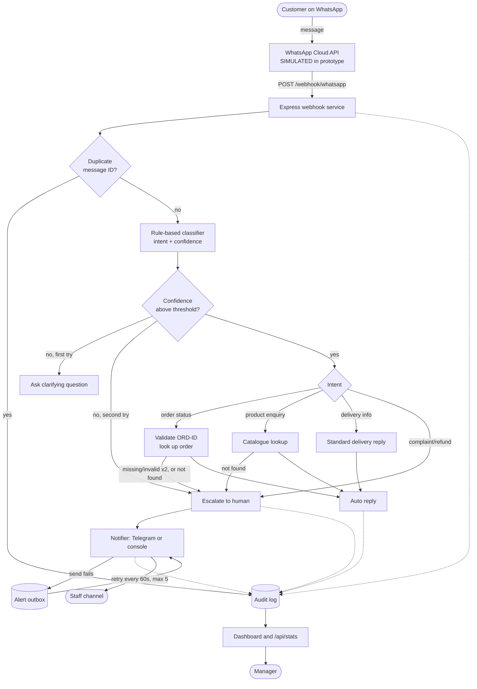

# Retail WhatsApp Automation: Lead Systems & Automation Engineer Assessment

**Candidate:** Emmanuel Seun Shittu  
**Assessment:** Angel Intelligence Limited, Lead Systems & Automation Engineer Technical Assessment (Version 1.1)  
**Chosen context:** Retail and order enquiries for a fictional shop, _Zuri Gadgets & Wears_ (Benin City, Edo State)

A WhatsApp-style automation system that answers routine customer enquiries instantly, hands sensitive or unclear cases to a human, alerts staff, and records every step in an audit log with a live operations dashboard.

> **Status:** assessment prototype using synthetic data only. Not deployed to any third-party production environment.

---

## Contents

1. [What it does](#what-it-does)
2. [Architecture](#architecture)
3. [Quick start](#quick-start)
4. [Demo scenarios and test inputs](#demo-scenarios-and-test-inputs)
5. [Automated tests](#automated-tests)
6. [Configuration](#configuration)
7. [API endpoints](#api-endpoints)
8. [Project structure](#project-structure)
9. [Working vs simulated](#working-vs-simulated)
10. [Known limitations](#known-limitations)
11. [Use of AI and external resources](#use-of-ai-and-external-resources)
12. [How this design maps to n8n](#how-this-design-maps-to-n8n)

---

## What it does

| Capability                    | How it works                                                                                                  |
| ----------------------------- | ------------------------------------------------------------------------------------------------------------- |
| **Receive messages**          | `POST /webhook/whatsapp` accepts the WhatsApp Cloud API payload shape                                         |
| **Classify intent**           | Rule-based keyword scoring returns an intent and a confidence value                                           |
| **Answer routine requests**   | Order status, product price and stock, delivery information                                                   |
| **Collect and validate data** | Asks for an order ID (`ORD-1234` format) and re-asks, then escalates after 2 failed tries                     |
| **Escalate to a human**       | Complaints and refunds always escalate; so do unclear messages and failed lookups                             |
| **Notify staff**              | Alert carries a case reference, reason and intent only (no phone number or message text)                      |
| **Audit log**                 | Every step is stored with a timestamp (received, classified, replied, escalated, notified, duplicate, failed) |
| **Failure handling**          | Duplicate messages, low-confidence messages, and an alert-service outage with a retry outbox                  |
| **Operational view**          | Dashboard: volume, intents, escalation rate, unresolved cases, pending alerts                                 |

**Intents:** `order_status`, `product_enquiry`, `delivery_info`, `complaint_refund` (always human), plus a low-confidence fallback.

---

## Architecture



**Stack:** Node.js 22, TypeScript, Express, SQLite (built-in `node:sqlite`), plain HTML dashboard. No paid services are required.

---

## Quick start

**Requirements:** Node.js **22.13 or newer** (check with `node -v`).

```bash
cd 02_Prototype
npm install
```

Create your settings file and set a password:

```powershell
# Windows PowerShell
copy .env.example .env
```

```bash
# macOS / Linux
cp .env.example .env
```

Open `.env` and set `DASHBOARD_PASSWORD` and `VERIFY_TOKEN`. Then:

```bash
npm test      # 13 scenarios on a throwaway database, expect "13/13 passed"
npm start     # http://localhost:3000/
```

Sign in to the dashboard as **`manager`** (or your `DASHBOARD_USER`) with your password.

> **Expected warning:** Node prints _"SQLite is an experimental feature and might change at any time"_. This is a Node notice about the built-in `node:sqlite` module, not an error. It was chosen to avoid native build dependencies so a reviewer can run the project easily. For production, use better-sqlite3 or managed Postgres.

Send a test message from a second terminal:

```powershell
# Windows PowerShell
curl.exe -X POST localhost:3000/webhook/whatsapp -H "content-type: application/json" -d "@test_inputs/order_status.json"
```

```bash
# macOS / Linux
curl -X POST localhost:3000/webhook/whatsapp -H "content-type: application/json" -d @test_inputs/order_status.json
```

Refresh the dashboard to see the message, its classification and the reply in the audit log.

---

## Demo scenarios and test inputs

All inputs are in `02_Prototype/test_inputs/` and use synthetic data.

| File                               | Scenario                         | Expected result                                           |
| ---------------------------------- | -------------------------------- | --------------------------------------------------------- |
| `order_status.json`                | Order enquiry with ID            | Replies with order status                                 |
| `product_enquiry.json`             | Price and stock question         | Replies with price and stock                              |
| `delivery_info.json`               | Delivery question                | Replies with Benin City (Edo State) delivery time and fee |
| `refund_escalation.json`           | Refund complaint                 | Escalated to a human, staff alert raised                  |
| `unclear_1.json`, `unclear_2.json` | Vague messages                   | First: clarifying question. Second: escalation            |
| `refund_escalation_2.json`         | Complaint during an alert outage | Customer still gets the handover reply; alert queued      |

**Message IDs are unique per file.** Re-sending a file is treated as a duplicate on purpose. To re-run a scenario, stop the server, delete `data.db`, and start again.

### Failure path: alert-service outage

1. Set `NOTIFY_FORCE_FAIL=1` in `.env` and restart the server.
2. Send `refund_escalation_2.json`.
3. Expect: customer reply still sent, dashboard shows **Alerts pending: 1**, audit log shows `notify_failed_queued`.
4. Set `NOTIFY_FORCE_FAIL=0`, restart, and wait up to 60 seconds. The alert is re-sent (`outbox_retry_sent`) and pending returns to 0.

---

## Automated tests

```bash
npm test
```

Runs 13 scenarios against the real handler using a temporary database and regenerates [`03_Test_Record.md`](03_Test_Record.md) (input, expected result, actual result). Coverage:

- every intent and the guided order-ID flow
- human escalation
- failure conditions: duplicate message, low-confidence message, alert outage (including recovery)
- data minimisation (staff alerts contain no phone number or message text)

---

## Configuration

Set in `.env` (see `.env.example`). Never commit real values.

| Variable                                 | Purpose                                                              | Default     |
| ---------------------------------------- | -------------------------------------------------------------------- | ----------- |
| `PORT`                                   | Server port                                                          | `3000`      |
| `VERIFY_TOKEN`                           | Webhook verification token                                           | `dev-token` |
| `DB_PATH`                                | SQLite file location                                                 | `data.db`   |
| `DASHBOARD_USER`                         | Dashboard and API username                                           | `manager`   |
| `DASHBOARD_PASSWORD`                     | Dashboard and API password (**required when `NODE_ENV=production`**) | none        |
| `CONFIDENCE_THRESHOLD`                   | Minimum classifier confidence before auto-reply                      | `0.5`       |
| `TELEGRAM_BOT_TOKEN`, `TELEGRAM_CHAT_ID` | Optional real staff alerts. If empty, alerts print to the console    | empty       |
| `NOTIFY_FORCE_FAIL`                      | `1` simulates an alert-service outage                                | `0`         |

---

## API endpoints

| Method and path          | Auth  | Description                                          |
| ------------------------ | ----- | ---------------------------------------------------- |
| `GET /webhook/whatsapp`  | none  | Webhook verification (`VERIFY_TOKEN`)                |
| `POST /webhook/whatsapp` | none  | Receive messages (open so the provider can reach it) |
| `GET /`                  | Basic | Operations dashboard                                 |
| `GET /api/stats`         | Basic | Counts, intents, escalation rate, pending alerts     |
| `GET /api/events`        | Basic | Recent audit log (phone numbers masked)              |

---

## Project structure

```text
EmmanuelShittu_AIL_Assessment/
├── 01_Written_Submission.pdf   Items A, B, E, F, G, H (source: 01_Written_Submission.md)
├── 02_Prototype/
│   ├── src/
│   │   ├── server.ts           Express app, auth, webhook, API
│   │   ├── handler.ts          Message flow and escalation logic
│   │   ├── classifier.ts       Keyword intent scoring
│   │   ├── notifier.ts         Staff alerts, outbox and retry
│   │   ├── db.ts               SQLite schema, seed data, audit helper
│   │   └── run-tests.ts        Scenario tests, writes the test record
│   ├── public/index.html       Operations dashboard
│   ├── test_inputs/            Synthetic WhatsApp-style payloads
│   ├── .env.example            Settings template (placeholders only)
│   └── package.json
├── 03_Test_Record.md           Expected vs actual for every scenario
├── 04_Demo_Video_Link.txt      Link to the demonstration video
└── README.md
```

---

## Working vs simulated

| Component                                                                                                                                           | Status                                                                                                                                                                                 |
| --------------------------------------------------------------------------------------------------------------------------------------------------- | -------------------------------------------------------------------------------------------------------------------------------------------------------------------------------------- |
| Webhook, classification, replies, validation, escalation, audit log, dashboard, duplicate handling, alert outbox with retry, dashboard login, tests | **Working**                                                                                                                                                                            |
| WhatsApp delivery                                                                                                                                   | **Simulated.** Messages are posted to the webhook in the Cloud API payload shape; replies are returned in the HTTP response. In production Meta's webhook points at the same endpoint. |
| Staff alerts                                                                                                                                        | **Simulated by default** (console). Real Telegram delivery works when the Telegram variables are set.                                                                                  |
| Orders, products, delivery data                                                                                                                     | **Synthetic seed data** in `src/db.ts`                                                                                                                                                 |

---

## Known limitations

- Keyword classifier: no language understanding. Pidgin and local-language messages fall to a human.
- Dashboard login is a single shared account over HTTP Basic. Production needs HTTPS and per-person accounts.
- Webhook signature verification and an audit-log retention purge are not implemented.
- "Unresolved" counts open conversations per customer, not individual cases.
- Dashboard timestamps are UTC (WAT is UTC+1).
- If the alert service is down for more than about 5 minutes, queued alerts stop retrying and need a manual reset (see the runbook in the written submission).
- `node:sqlite` is experimental in Node; production should use better-sqlite3 or managed Postgres.

---

## Use of AI and external resources

This disclosure is provided as required by Section 7 of the assessment brief.

- **AI assistant: Claude (Anthropic).** Used to help scaffold the TypeScript service, the tests and the dashboard; to draft the written sections; to produce the architecture diagram source (Mermaid); and to research current WhatsApp Business messaging pricing and the Nigeria Data Protection Act 2023 provisions cited in the cost and risk sections.
- **Responsibility:** I remain responsible for every technical decision and every part of this submission, and I will explain, modify and debug it in the live stages.
- **Libraries and tools:** Node.js (built-in `node:sqlite`), Express, tsx, TypeScript, Mermaid CLI (diagram rendering), pandoc and wkhtmltopdf (PDF conversion).
- **Templates and proprietary work:** none copied from other projects. No proprietary work of a current or former employer or client is included.
- **Data:** synthetic only. No real customer, patient or confidential data is used.

---

## How this design maps to n8n

Not built for this submission; included for discussion.

| This project                       | n8n equivalent                            |
| ---------------------------------- | ----------------------------------------- |
| `POST /webhook/whatsapp` route     | Webhook trigger node                      |
| Duplicate check (`seen_messages`)  | Database lookup node + IF node            |
| `classifier.ts`                    | Code node (same keyword scoring)          |
| Intent branches in `handler.ts`    | Switch node, one branch per intent        |
| Order and product lookups, replies | Database and HTTP Request nodes           |
| Escalation and staff alert         | Telegram node (case reference only)       |
| `audit_log` inserts                | Database insert node on every branch      |
| Alert outbox and 60-second retry   | Error Trigger workflow + Schedule trigger |
